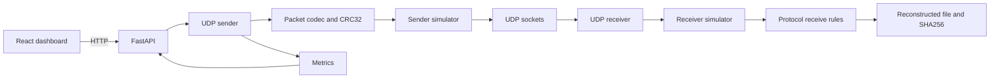

# ReliableUDP

ReliableUDP is a file transfer application that sends real UDP datagrams and adds reliability in the application layer. It implements Stop and Wait, Go Back N, and Selective Repeat, checks each packet with CRC32, checks the finished file with SHA256, and shows live progress in a React dashboard.

UDP itself does not provide delivery, ordering, duplicate suppression, or retransmission. This project adds those behaviours above the socket.

## Features

- Binary packet format with a 48-byte header and CRC32
- Stop and Wait, with a window of one
- Go Back N, with a sliding window and cumulative acknowledgements
- Selective Repeat, with per-packet acknowledgements and retransmission of only missing packets
- Configurable packet loss, artificial delay, and bit corruption on the real UDP path
- Automatic local UDP receiver, plus a standalone receiver for another computer
- Live metrics: progress, throughput, RTT, retransmissions, simulator drops, and integrity
- Protocol comparison that sends the same file with all three protocols
- Download of the reconstructed file only after SHA256 verification

## Architecture



HTTP is used for the dashboard: uploads, status, and downloads. The file bytes move through UDP sockets.

## Prerequisites

- Python 3.11 or newer
- [uv](https://docs.astral.sh/uv/) for the Python environment
- Node.js 18 or newer, with npm
- macOS, Linux, or Windows

This repository was developed with Python 3.11.9 and Node.js 24.

## Folder structure

```text
backend/app/          UDP sender, receiver, protocols, API
backend/tests/        pytest suite
frontend/             React dashboard
uploads/              created at runtime, not committed
received_files/       reconstructed files, not committed
reports/              technical report
```

## Install

From the repository root.

Install uv once if `uv --version` fails. On macOS:

```bash
brew install uv
```

On Linux: `curl -LsSf https://astral.sh/uv/install.sh | sh`

On Windows PowerShell: `powershell -ExecutionPolicy ByPass -c "irm https://astral.sh/uv/install.ps1 | iex"`

### macOS and Linux

```bash
uv sync
cd frontend
npm install
cd ..
```

### Windows PowerShell

```powershell
uv sync
cd frontend
npm install
cd ..
```

`uv sync` creates `.venv` in the repository root and installs the backend dependencies, including pytest. You do not activate the virtual environment for the commands below. `uv run` uses it.

Optional settings live in `.env.example`. Copy it to `.env` only if you want to change ports or directories. The backend reads environment variables; it does not load `.env` automatically.

## Run the dashboard

From the repository root, one command installs anything missing and starts both processes. Stop them with Ctrl+C.

```bash
./dev.sh
```

Open `http://127.0.0.1:5173`. The API is at `http://127.0.0.1:8000`, and the built-in UDP receiver listens on `127.0.0.1:9000`. API reference: `http://127.0.0.1:8000/docs`.

To run them separately:

```bash
uv run uvicorn app.main:app --app-dir backend --reload --host 127.0.0.1 --port 8000
```

```bash
cd frontend
npm run dev
```

## Send a file

1. Open the dashboard.
2. Confirm the header shows the API online and the UDP receiver listening.
3. Choose a file. Binary files are supported.
4. Choose Stop and Wait, Go Back N, or Selective Repeat.
5. Set the receiver host and UDP port. The defaults point at the built-in receiver.
6. Optionally set loss, delay, and corruption.
7. Click **Start transfer**.
8. Watch progress, retransmissions, throughput, and RTT.
9. When integrity says **Verified**, use **Download** in the history table. That file is the reconstructed output, not the upload.

Stop and Wait disables the window field because its effective window is always 1.

If you set artificial delay, raise the acknowledgement timeout above that delay. The timer starts after the sender has applied its own simulated delay. The receiver's delay still has to fit inside the timeout. A practical minimum is the delay plus 150 ms.

## Protocol comparison

Click **Run protocol comparison**. If no file is selected, the backend generates a 32 KB test file and sends it with all three protocols, one after another, using the form's loss, delay, corruption, chunk size, timeout, and retry settings. Go Back N and Selective Repeat use the configured window. Stop and Wait still uses window 1.

The charts update from the measured results. An empty chart means that measurement was not produced. The page does not fill in a winner.

**Demo settings** loads a presentation preset: 10% loss, 40 ms delay, 2% corruption, 512-byte chunks, window 8, and a 500 ms timeout. The transfer is still real.

## Standalone receiver

Use this when the receiver is another process or another computer. Stop the dashboard backend first if it is already bound to port 9000, or pick another port.

From the repository root:

```bash
PYTHONPATH=backend uv run python -m app.receiver --host 0.0.0.0 --port 9000 --output received_files
```

Simulation on the receiver applies to datagrams it sends, which are mostly acknowledgements:

```bash
PYTHONPATH=backend uv run python -m app.receiver --host 0.0.0.0 --port 9000 --loss 10 --delay-ms 40 --corruption 2
```

Standalone sender:

```bash
PYTHONPATH=backend uv run python -m app.sender --file README.md --host 127.0.0.1 --port 9000 --protocol go_back_n --window 8
```

## Two computers on the same network

1. On the receiving computer, start `app.receiver` bound to `0.0.0.0` and a chosen UDP port.
2. Allow that UDP port through the firewall.
3. Find the receiver's LAN address, for example with `ipconfig getifaddr en0` on macOS or `ipconfig` on Windows.
4. On the sending computer, set **Receiver host** to that address and **Receiver UDP port** to the chosen port.
5. Do not assume `127.0.0.1`. That address only reaches a receiver on the same machine.

The dashboard simulator affects datagrams leaving the sender, and acknowledgements only when the built-in receiver is the destination. For a remote receiver, pass `--loss`, `--delay-ms`, and `--corruption` on that machine if acknowledgements should also be impaired.

If packets never arrive, check that both machines are on the same network, the port matches, and the firewall allows inbound UDP.

## Tests

### Backend

From the repository root:

```bash
uv run pytest
```

Tests use temporary directories and ephemeral UDP ports.

### Frontend

```bash
cd frontend
npm test
npm run build
```

`npm test` checks formatting helpers. `npm run build` must succeed before a presentation.

## Reading the graphs

- **Progress** is the percentage of original file bytes acknowledged over time. Retransmissions do not increase the percentage.
- **Throughput** is acknowledged file bytes divided by transfer duration. It is not the rate of repeated transmissions.
- **RTT** is the time from the start of a data transmission until its acknowledgement, recorded only when that packet was not retransmitted. If every sample was retransmitted, RTT is shown as unavailable.
- **Retransmissions** count extra DATA sends after the first send of a sequence number.
- **Simulated loss** is datagrams the simulator dropped divided by datagrams submitted to it. That includes data and, with the built-in receiver, acknowledgements. It is separate from the retransmission rate.

## Troubleshooting

| Symptom | What to check |
| --- | --- |
| API unreachable | The backend is not running on port 8000, or the frontend was not started with the Vite proxy. |
| Receiver did not become ready | Host, UDP port, or firewall. The header shows whether the built-in receiver is listening. |
| Port already in use | Another ReliableUDP process is still running. Stop it or change `RELIABLEUDP_PORT` / `RELIABLEUDP_API_PORT`. |
| Transfer fails immediately under delay | Increase the acknowledgement timeout. |
| High loss and a small retry limit | The transfer is supposed to fail when recovery is exhausted. Raise retries or lower loss. |
| Download unavailable | The transfer is not verified, or the receiver was a different computer. Copy the file from that computer's output directory. |
| History disappeared | History is stored in memory and clears when the backend process stops. |

Uploaded files are treated as data and are not executed.
