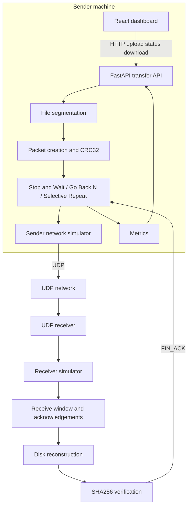
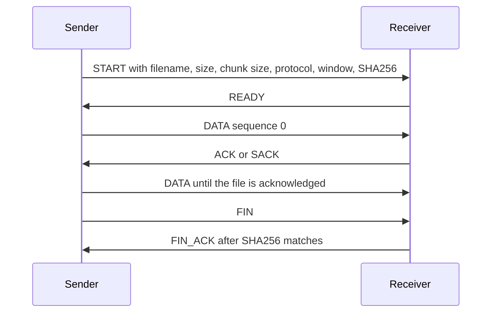
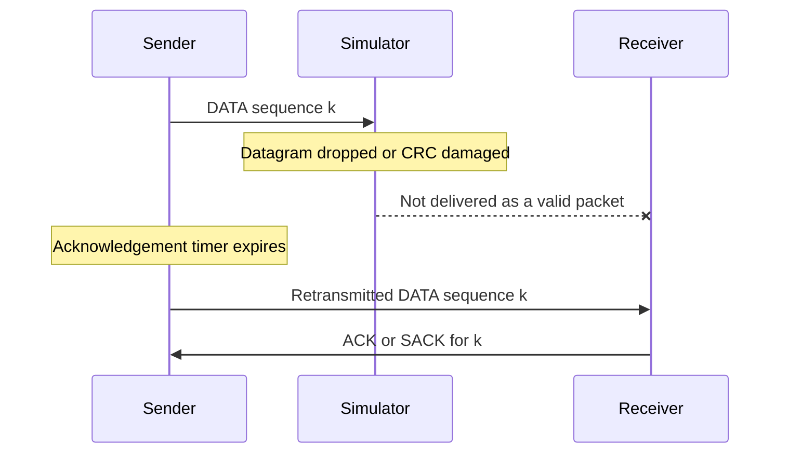

# ReliableUDP: A Reliable File Transfer Protocol over UDP

## Abstract

ReliableUDP transfers files over UDP and implements reliability in the application. The sender segments a file into packets, protects each datagram with CRC32, and runs Stop and Wait, Go Back N, or Selective Repeat. The receiver reconstructs the file on disk and accepts it only when the size and SHA256 hash match the metadata from the sender. A FastAPI service controls transfers, and a React dashboard displays measurements taken from those transfers. Loss, delay, and corruption are applied to the UDP datagrams before they are sent, so the reliability logic is exercised on real sockets rather than on an in-memory copy of the file.

## Problem statement

UDP provides a checksum and a best-effort datagram service. It does not recover lost packets, reorder them, or suppress duplicates. A file transfer needs those properties. This project places them in the application and makes the behaviour visible: the user can damage the path on purpose and watch retransmission, throughput, and integrity.

## Objectives

- Define a binary packet format with sequence numbers, acknowledgements, and CRC32.
- Transfer arbitrary bytes, including empty files and files larger than one packet.
- Implement Stop and Wait, Go Back N, and Selective Repeat as separate sender behaviours.
- Reconstruct the file and confirm SHA256 before reporting success.
- Expose configuration, progress, metrics, download, and a three-protocol comparison through a dashboard.

## System architecture

The browser talks to FastAPI over HTTP. The API stores the upload and starts a sender thread. The sender and the built-in receiver exchange UDP datagrams on localhost, or the sender can address a standalone receiver. Metrics are updated during the transfer and read by the dashboard through polling.







What the software does, as distinct from the textbook description, is specified in the algorithm sections below.

## Software and technology stack

- Python 3.11, `socket`, `struct`, `zlib.crc32`, `hashlib.sha256`, `threading`, and `time.monotonic`
- FastAPI, Uvicorn, and Pydantic
- pytest
- React 18, Vite 6, Tailwind CSS, and Recharts

The implementation runs the transfer on a background thread so the HTTP server can keep answering status requests.

## Packet format

Every datagram uses one big-endian header of 48 bytes, followed by the payload. The layout is defined by `struct` format `>4sBBH16sQQII` in `backend/app/packet.py`.

| Field | Size | Meaning |
| --- | --- | --- |
| Magic | 4 | `RUDP` |
| Version | 1 | `1` |
| Packet type | 1 | START, READY, DATA, ACK, SACK, FIN, FIN_ACK, or ERROR |
| Flags | 2 | Bit 0 marks a retransmission |
| Transfer id | 16 | UUID bytes |
| Sequence | 8 | Unsigned. Data sequences start at 0 |
| Acknowledgement | 8 | Unsigned. Meaning depends on the packet type |
| Payload length | 4 | Byte length of the payload |
| CRC32 | 4 | IEEE CRC32 of the header with this field set to zero, then the payload |

An encoded DATA packet observed from this implementation, with transfer id `00112233445566778899aabbccddeeff`, sequence 0, acknowledgement 0, and payload `Hi`, begins with this 48-byte header:

`525544500103000000112233445566778899aabbccddeeff0000000000000000000000000000000000000002d54f102c`

Decoding rejects a short buffer, a bad magic value, a version other than 1, an unknown type, a length that does not match the bytes after the header, and a CRC32 mismatch. A rejected datagram is not written into the file.

Control payloads are compact JSON. DATA payloads are the raw file bytes. A cumulative ACK's acknowledgement number is the next sequence the receiver expects. A SACK's acknowledgement number is the one sequence being acknowledged. Those two types are not interchangeable.

The default DATA payload is 1024 bytes. The allowed range is 64 to 1400 bytes so a datagram stays under a typical 1500-byte Ethernet MTU after the 48-byte header and UDP/IP overhead.

## Client sender design

`perform_transfer` hashes the file, builds START metadata, binds an ephemeral UDP port, and calls the selected protocol. The sender does not treat transmission of FIN as success. It waits for FIN_ACK with `ok: true` and the same SHA256. A missing confirmation, a hash mismatch, a retry limit, or cancellation ends in a failed or cancelled status.

Handshake and FIN messages use the same retry limit as data. The receiver answers a repeated START with READY again, and a repeated FIN with the same FIN_ACK, so a lost control reply can be recovered.

## Receiver design

The built-in receiver starts with the API and binds `127.0.0.1:9000` unless `RELIABLEUDP_HOST` or `RELIABLEUDP_PORT` is set. `python -m app.receiver` is the standalone process and can bind `0.0.0.0`.

The receiver validates START metadata before creating a file. The output name is the transfer id plus a sanitized filename, inside the configured output directory. Path components such as `../` are removed. A partial file is deleted if verification fails or the sender reports cancellation. A verified file is renamed into place and a sidecar `.meta.json` records the hash.

Stop and Wait and Go Back N receivers accept only the next in-order DATA packet. Anything else is discarded, and the cumulative ACK repeats the current next-expected sequence. Selective Repeat accepts DATA inside `[recv_base, recv_base + window)`, writes it at `sequence * chunk_size`, returns a SACK, and advances `recv_base` across the contiguous prefix. A duplicate below `recv_base` is SACKed again and is not written twice.

## File segmentation and reconstruction

The chunk count is 0 for an empty file and otherwise `ceil(file_size / chunk_size)`. The last chunk is shorter when the size is not a multiple of the chunk size. The sender reads chunks by seeking to `sequence * chunk_size`, which is what retransmission needs. The receiver uses the same offset. The transfer is complete only when every expected sequence has been accepted and the file size matches.

## CRC32 and SHA256 integrity verification

CRC32 covers one datagram and is checked before the payload can be stored. SHA256 is computed on the original file before START and again on the reconstructed file before FIN_ACK. Success requires both the hash and the size to match. The dashboard shows verification only when the API reports `integrity: verified`.

An observed check: a 4304-byte binary payload, including a PNG-style prefix and interior null bytes, was sent with Selective Repeat. The API reported SHA256 `f817060b5cda602edaa597f6e06fb4f8d06b203171788df40fa59ffd1435ff36`, and the downloaded reconstructed file was byte-for-byte identical.

## Stop and Wait algorithm

Implemented in `backend/app/protocols/stop_and_wait.py`.

The sender transmits one DATA packet and waits for an ACK whose acknowledgement number is `sequence + 1`. On timeout it retransmits that packet. After more timeouts than `max_retries`, it fails. Duplicate or other ACK numbers are ignored until the deadline. The configured window is ignored and the reported window is 1. The receiver accepts a packet only when its sequence equals the next expected value.

This was checked by a lossless multi-packet transfer whose event log shows a single send before the first acknowledgement, by recovery from one dropped DATA packet, one dropped ACK, and one corrupted DATA packet, and by a 100% DATA drop that ends in retry exhaustion instead of success.

## Go Back N algorithm

Implemented in `backend/app/protocols/go_back_n.py`.

The sender keeps `base` as the oldest unacknowledged sequence and `next_seq` as the next sequence to send. It may have `window_size` packets outstanding. Acknowledgements are cumulative: an ACK of `n` accepts every sequence below `n` and moves `base` to `n`. If the timer for `base` expires, every packet from `base` to `next_seq - 1` is retransmitted. Duplicate ACKs do not move `base` and do not by themselves cause a fast retransmit.

The receiver discards out-of-order and duplicate data. A unit test delivers sequence 1 before sequence 0 and checks that sequence 1 is not stored until sequence 0 arrives. An integration test drops sequence 2 once in a window of 4 and checks that the retransmission set contains 2 and at least one later outstanding sequence, then that the file matches.

## Selective Repeat algorithm

Implemented in `backend/app/protocols/selective_repeat.py`.

The sender records each SACK separately and retransmits only sequences whose own timer has expired and that are still unacknowledged. The receive window accepts out-of-order packets inside its range, ignores packets beyond that range, and slides when the lowest sequence becomes contiguous. A test that drops only sequence 2 completes with the retransmission set equal to `{2}`.

SACK and cumulative ACK are different packet types, so a Selective Repeat sender does not treat a cumulative ACK as progress.

## Sliding window and timeout handling

Timeouts use `time.monotonic()`. The acknowledgement timer starts when `send` returns, which is after any sender-side artificial delay, because the peer cannot have answered before the datagram was handed to UDP. RTT is measured from the time just before that delay, so the sample includes sender-side delay when a delay is configured. RTT is stored only if that sequence was not retransmitted, avoiding an acknowledgement being paired with an ambiguous earlier copy.

`max_retries` is the number of extra DATA transmissions allowed for a sequence or, for Go Back N, the number of window timeouts allowed without the base advancing. Handshake and FIN use the same limit. Socket waits are capped at 200 ms so cancellation is noticed without a busy loop. The Selective Repeat sender drains buffered SACKs and blocks until the next per-packet deadline; it does not insert a fixed pause after a normal acknowledgement.

## Network simulation methodology

`NetworkSimulator` does not parse packets. The caller labels each datagram as data, retransmission, ack, sack, or control.

A datagram is dropped when a test predicate says so or when a uniform random draw is below the loss probability. A dropped datagram is not passed to `sendto`. Corruption flips one bit in a copy of the datagram and is counted separately; the CRC32 check at the receiver rejects it. Delay sleeps for a uniform random duration between 50% and 100% of the configured bound before the socket send.

With the built-in receiver, the sender's simulator covers datagrams the sender emits, and the receiver's simulator covers READY, ACK, SACK, and FIN_ACK. A remote `app.receiver` applies simulation only to its own outgoing datagrams, and only when its CLI flags request it. The dashboard shows the simulator's drop and corruption counters. It does not invent a drop that the simulator did not perform.

The drop rate is `dropped / attempted` across submitted datagrams. Data drops are also counted from the `data` and `data_retransmission` categories.

Seeded simulators repeat the same random decisions. Tests check a 50% loss setting over 2000 draws and require the same seed to produce the same count, within a wide band around 1000.

## Performance metrics and their formulas

| Metric | Formula used in this code |
| --- | --- |
| Duration | Monotonic time from transfer start to completion or failure |
| Progress | `bytes_acked / file_size`, or 100% for an empty file once verification starts |
| Average throughput | `bytes_acked / duration` |
| Current throughput | Change in acknowledged bytes over the latest sample span of about one second, when that span exists |
| Average RTT | Mean of RTT samples from transmissions that were not repeated |
| Minimum and maximum RTT | Extremes of those samples, or unavailable when there are none |
| Original data packets | Chunk count |
| Transmission attempts | DATA sends, including retransmissions |
| Retransmissions | DATA sends after the first send of that sequence |
| Simulator drop rate | Simulator drops divided by simulator submissions |
| Integrity | `verified` only after matching SHA256 and size |

Throughput does not treat retransmitted bytes as new file data.

## Dashboard description

The React page shows API and UDP receiver health, a transfer form, a live monitor, metric cards, simulator counters, a progress line chart, comparison bar charts, and history. Polling reads `/api/transfers/{id}` about every 400 ms while a transfer is active. Stop and Wait locks the window at 1. Download links are rendered only when the API sets `download_available`.

## API description

| Method | Path | Role |
| --- | --- | --- |
| GET | `/api/health` | API and UDP receiver status |
| GET | `/api/config` | Protocols, defaults, and limits |
| POST | `/api/transfers` | Upload a file and start UDP transfer |
| GET | `/api/transfers` | Recent transfers |
| GET | `/api/transfers/{id}` | Status and metrics |
| POST | `/api/transfers/{id}/cancel` | Request cancellation |
| GET | `/api/transfers/{id}/download` | Verified reconstructed file |
| GET | `/api/received-files` | Files in the output directory |
| POST | `/api/benchmark` | Run the three protocols sequentially |
| GET | `/api/benchmark` | Latest comparison |
| GET | `/api/benchmark/{id}` | One comparison |

Only one transfer or comparison runs at a time, because they share the built-in receiver. Interactive documentation is at `/docs` when the API is running.

## Testing methodology

pytest covers the codec, file hashing and reassembly, simulator probabilities and bit corruption, each protocol's receiver rules, and UDP transfers on ephemeral localhost ports. Integration tests compare reconstructed bytes with the original for empty, small, binary, and multi-packet files under all three protocols, including a seeded loss and corruption case. They also require failure when FIN_ACK never arrives, exercise the HTTP upload and download, run a three-protocol benchmark, and check that cancellation cannot be reported as verified.

The frontend test checks number formatting. `npm run build` compiles the dashboard.

Tests write under pytest's temporary directory. They do not use the project's `received_files` folder.

## Actual test results

Command, from `backend`, after the implementation was complete:

```text
python -m pytest -q
```

Result: 40 passed. Pytest also printed a Starlette deprecation warning about its TestClient. That warning is not a failure.

Frontend, from `frontend`:

```text
npm test
```

Result: 4 passed.

```text
npm run build
```

Result: Vite production build completed.

One comparison started from the dashboard on 11 October 2026, against the built-in receiver on localhost. The file was the generated 32,768-byte benchmark file. Chunk size was 1024 bytes, acknowledgement timeout was 500 ms, the retry limit was 8, and loss, delay, and corruption were 0. Stop and Wait used window 1. The other two protocols used window 8.

| Protocol | Duration (s) | Throughput (B/s) | Average RTT (ms) | Retransmissions | Integrity |
| --- | ---: | ---: | ---: | ---: | --- |
| Stop and Wait | 0.019051 | 1720044.841 | 0.147 | 0 | verified |
| Go Back N | 0.007329 | 4470827.532 | 0.940 | 0 | verified |
| Selective Repeat | 0.004935 | 6639414.500 | 0.488 | 0 | verified |

These figures are one run on an unloaded local machine with no simulated faults. They are not a general ranking. Another run, a larger file, or nonzero loss and delay will change them. The dashboard table is the place to read the run you just executed.

## Instructions for installation and execution

See the repository `README.md`. Short form from the repository root:

```bash
python3 -m venv .venv
source .venv/bin/activate
python -m pip install -r backend/requirements.txt
python -m uvicorn app.main:app --app-dir backend --host 127.0.0.1 --port 8000
```

In another terminal:

```bash
cd frontend
npm install
npm run dev
```

Then open `http://127.0.0.1:5173`.

## Limitations

- Transfer history and benchmark results live in the API process and disappear when it stops.
- One built-in receiver is shared, so transfers and comparisons run one at a time.
- Very high loss with a short retry limit fails the transfer. That is the retry limit working.
- RTT is unavailable when every measured packet had to be retransmitted.
- Sender-side simulated delay is included in the RTT sample but not in the acknowledgement timer. Receiver-side delay is included in both.
- A remote receiver does not automatically use the dashboard's loss settings for acknowledgements.
- The progress chart needs at least two samples. A transfer that acknowledges no additional bytes produces an empty chart rather than a fabricated line.
- npm reports dependency audit findings in the frontend toolchain. They were not treated as protocol defects.

## Possible future improvements

- Persist history and benchmark results.
- Estimate the timeout from measured RTT.
- Run the sender and receiver as separate deployable services with authentication if this were more than a lab project.
- Add an explicit sequence trace view with one row per packet.

## Conclusion

The application sends file bytes through UDP and recovers them with three application-layer protocols. Packet CRC32 and file SHA256 are both enforced before success is reported. The dashboard and the comparison charts read those measured results. Automated tests cover the codec, the three protocols, simulated faults, and the HTTP API, and the pytest run recorded above completed with 40 passes.
